<div align="center">

# 🛡️ Passive Mine Detection and Classification
### Hệ thống hỗ trợ phát hiện và phân loại vật thể chôn ngầm

[](https://python.org)
[](https://streamlit.io)
[](https://scikit-learn.org)
[](LICENSE)
[](https://passive-mine-detection.streamlit.app)

</div>

---

> ### ⚠️ GIỚI HẠN AN TOÀN
>
> Hệ thống **chỉ hỗ trợ sắp xếp thứ tự ưu tiên đào**, không xác định vùng an toàn.
> Mọi tín hiệu **vẫn phải được đào kiểm tra đầy đủ** theo quy trình IMAS.
> Mô hình huấn luyện trên **338 mẫu phòng thí nghiệm**, không phải bãi mìn thật.

---

## Tổng quan

Đề tài phản biện và đánh giá lại bài báo:

> Yilmaz, C., Kahraman, H. T., & Söyler, S. (2018). *Passive Mine Detection and
> Classification Method Based on Hybrid Model*. **IEEE Access**, 6, 47870–47888.
> DOI: [10.1109/ACCESS.2018.2866538](https://doi.org/10.1109/ACCESS.2018.2866538)

Bài báo công bố **98,2% phát hiện** và **85,8% phân loại**. Đề tài tái hiện bài báo, chỉ ra
**hai nguồn làm con số tăng cao**, đo lại bằng quy trình không rò rỉ, rồi xây dựng một sản phẩm
xếp hạng ưu tiên đào dựa trên kết quả trung thực.

---

## Kết quả chính

### Hai nguồn làm tăng con số công bố (`02_tai_hien_paper`, `03_khac_phuc_ro_ri`)

| Nguồn | Cơ chế | Mức tăng |
|---|---|:---:|
| **Fuzzy metric** | Độ đo khoảng cách mờ (công thức gốc sau paywall, không tái lập được) | +7,1 (phát hiện) · **+26,6** (phân loại) |
| **Rò rỉ hàm thích nghi** | GA tối ưu trọng số trên chính tập test (Công thức 3 + Thuật toán 1) | +3,1 · +6,8 điểm (Wilcoxon p < 0,002) |

### Phân rã khoảng cách

| Mức đánh giá | Phát hiện | Phân loại 5 lớp |
|---|:---:|:---:|
| **Bài báo công bố** (fuzzy + rò rỉ) | 98,2% | 85,8% |
| Tái hiện, độ đo chuẩn + rò rỉ trọng số | 93,5% | 63,4% |
| **Bỏ rò rỉ — nested CV** | **90,3% ± 4,0** | **62,0% ± 5,1** |
| Baseline đa số (không học gì) | 79,0% | 21,0% |

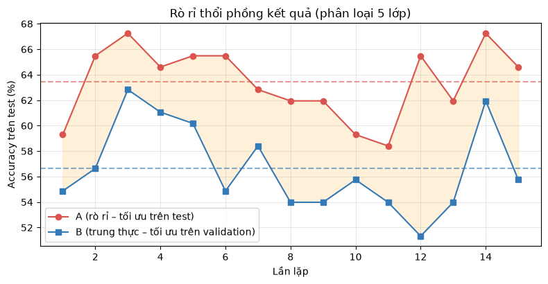

### Hiệu năng sản phẩm

Hai mô hình cho hai bài toán con (chi tiết: `Notebook/09_cai_thien_do_chinh_xac.ipynb`):
**phân loại** = MLP(16-8) + log V + one-hot loại đất; **phát hiện / xếp hạng** = HistGradientBoosting nhị phân.

| Chỉ số (CV lặp 5×3) | Bản cũ | **Bản hiện tại** |
|---|:---:|:---:|
| Phân loại 5 lớp | 59,5% | **71,8% ± 4,6** |
| Đúng trong top-2 loại | ~79% | **88,3%** |
| ROC-AUC phát hiện | — | **0,948** |
| Recall tại ngưỡng ưu tiên (đo trên test tách biệt) | — | **99,4% ± 1,0** |
| Giữ recall 100% trên dữ liệu mới | ~50% lần thử | ~75% lần thử |
| Không-mìn được xếp cuối hàng đợi | — | 27% |

### So sánh mô hình

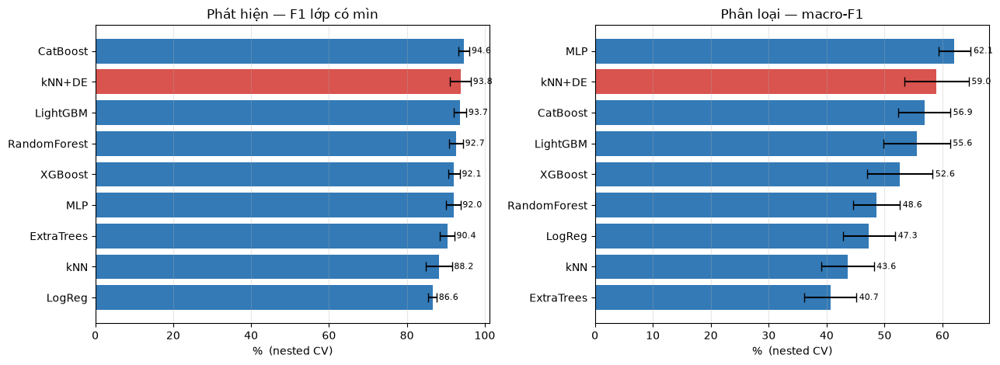
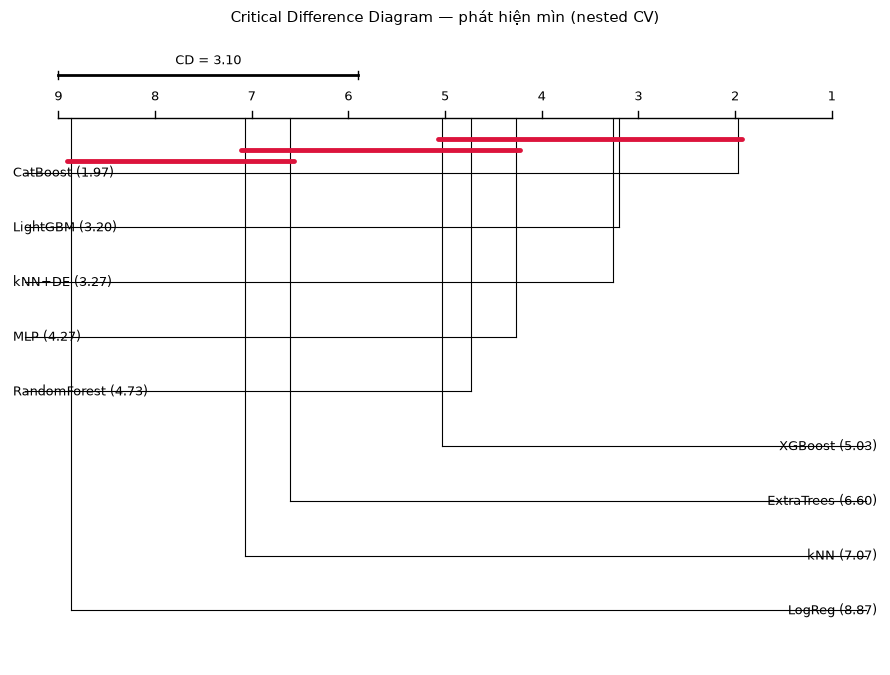

Kiểm định Friedman p ≈ 10⁻¹³ (phát hiện) và 10⁻¹⁷ (phân loại). Hậu kiểm Nemenyi (CD = 3,10):
nhóm đỉnh gồm k-NN+DE, CatBoost, LightGBM, MLP **không tách biệt được**. Nút thắt là dữ liệu
ít, không phải lựa chọn thuật toán.

### Giải thích mô hình

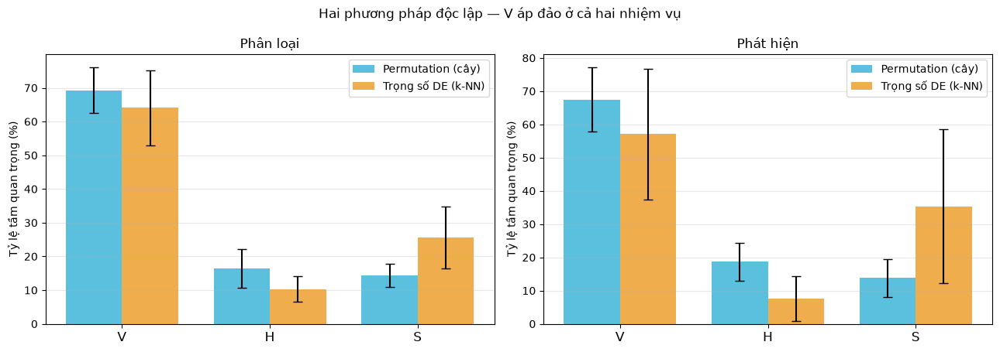
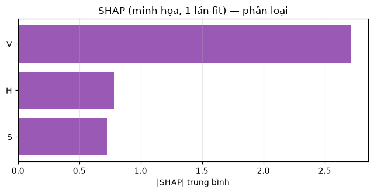

**V (điện áp dị thường từ) áp đảo** (57–69% tầm quan trọng) ở cả permutation importance,
trọng số DE lẫn SHAP, nhất quán với lý giải vật lý. Thứ tự giữa H và S không ổn định.

---

## Demo

🚀 **[passive-mine-detection.streamlit.app](https://passive-mine-detection.streamlit.app)**

**Cách dùng nhanh:**
1. Vào tab **Dự đoán hàng loạt**
2. Bấm **Dùng file mẫu**
3. Xem bảng xếp hạng → **Bản đồ rủi ro** → **Tổng quan**
4. Tải kết quả Excel

> File mẫu chính là dữ liệu huấn luyện gắn toạ độ giả lập, chỉ dùng để minh hoạ giao diện.

---

## Chạy local

Yêu cầu **Python 3.11, 3.12 hoặc 3.13** (đã kiểm thử với 3.11 và 3.13).

```bash
git clone https://github.com/tuan1507/passive-mine-detection-and-classification.git
cd passive-mine-detection-and-classification

python -m venv .venv
# Windows:
.venv\Scripts\activate
# Linux/macOS:
source .venv/bin/activate

# Chỉ chạy app:
pip install -r Notebook/product_v3/requirements.txt
# Hoặc chạy cả app lẫn 10 notebook:
pip install -r Notebook/requirements-notebooks.txt

streamlit run Notebook/product_v3/Home.py
```

Truy cập **http://localhost:8501**.

- `models/model.pkl` **đã có sẵn** trong repo nên app chạy ngay, không cần huấn luyện.
- Huấn luyện lại (khoảng 30 giây, cần sau khi sửa `core.py`): `python Notebook/product_v3/train_final.py`
- **Tự phục hồi:** nếu `model.pkl` thiếu, hỏng hoặc được tạo bằng phiên bản scikit-learn khác,
  app tự huấn luyện lại một lần khi khởi động.

**Notebook:** mở trong VS Code/Jupyter, chọn kernel `.venv` và chạy theo thứ tự 01 → 10.
Notebook 03, 04, 05, 09 mất vài phút mỗi cái. Notebook 10 kiểm thử tự động toàn bộ app.

---

## Deploy lên Streamlit Community Cloud

1. Vào [share.streamlit.io](https://share.streamlit.io), đăng nhập bằng GitHub, chọn **Create app**.
2. **GitHub URL:** `https://github.com/tuan1507/passive-mine-detection-and-classification/blob/main/Notebook/product_v3/Home.py`
3. **Advanced settings → Python version:** 3.11 (3.12, 3.13 cũng chạy được).
4. **Deploy.** Streamlit tự cài `Notebook/product_v3/requirements.txt` và nạp `model.pkl` có sẵn.

Mỗi lần `git push` lên `main`, app tự cập nhật.

---

## Cấu trúc dự án

```
passive-mine-detection-and-classification/
│
├── Notebook/
│   ├── product_v3/                  # Ứng dụng Streamlit
│   │   ├── Home.py                  # Entry point (st.navigation)
│   │   ├── core.py                  # Logic lõi: đặc trưng, 2 mô hình, CV, ngưỡng, dự đoán
│   │   ├── train_final.py           # Huấn luyện → models/model.pkl
│   │   ├── requirements.txt         # Thư viện cho app (local + Streamlit Cloud)
│   │   ├── Dockerfile
│   │   ├── models/model.pkl         # Mô hình đã huấn luyện (scikit-learn 1.5.2)
│   │   ├── app_pages/
│   │   │   ├── 0_Home_page.py       # Trang chủ + thông tin mô hình
│   │   │   ├── 1_Du_doan_hang_loat.py
│   │   │   ├── 2_Ban_do_rui_ro.py
│   │   │   ├── 3_Tong_quan.py
│   │   │   └── 4_Thu_don_le.py
│   │   └── data/
│   │       ├── raw/Mine_Dataset.xls
│   │       ├── sample_batch.xlsx
│   │       └── sample_batch.csv
│   │
│   ├── 01_kham_pha.ipynb … 10_kiem_thu_app.ipynb
│   └── requirements-notebooks.txt   # Thư viện cho app + notebook
│
├── Data/
│   └── Mine_Dataset_main.xls        # Bộ dữ liệu UCI Land Mines gốc
│
└── Result/
    └── Figures/                     # 21 biểu đồ từ các notebook
```

---

## Định dạng dữ liệu đầu vào

File CSV hoặc Excel với các cột:

| Cột | Bắt buộc | Khoảng | Cách chuẩn hoá |
|---|:---:|---|---|
| `V` | ✅ | [0, 1] | `V_raw / 10.6` (Volt) |
| `H` | ✅ | [0, 1] | `H_raw / 20.0` (cm) |
| `S` | ✅ | {0.0, 0.2, 0.4, 0.6, 0.8, 1.0} | loại đất |
| `id` | — | | định danh điểm |
| `x`, `y` | — | | toạ độ để vẽ bản đồ |

**6 loại đất (S):** 0.0 = Khô&cát · 0.2 = Khô&mùn · 0.4 = Khô&vôi · 0.6 = Ẩm&cát · 0.8 = Ẩm&mùn · 1.0 = Ẩm&vôi

App kiểm tra đầu vào và báo lỗi kèm số dòng nếu ô trống, không phải số, nằm ngoài [0, 1] hoặc S sai.

---

## Notebook phân tích

| # | Notebook | Nội dung |
|---|---|---|
| 01 | `01_kham_pha.ipynb` | EDA: phân bố, tương quan, ảnh hưởng H và S |
| 02 | `02_tai_hien_paper.ipynb` | Tái hiện Bảng 3 & 4, phân rã: fuzzy metric + rò rỉ |
| **03** | **`03_khac_phuc_ro_ri.ipynb`** | **Đóng góp chính: thí nghiệm A/B rò rỉ, nested CV, permutation importance** |
| 04 | `04_so_sanh_mo_hinh.ipynb` | So sánh 9 mô hình trên cùng khung |
| 05 | `05_kiem_dinh_thong_ke.ipynb` | Friedman, Nemenyi, CD Diagram |
| 06 | `06_chi_phi_loi.ipynb` | PR curve, chi phí bất đối xứng, ngưỡng CV |
| 07 | `07_giai_thich_model.ipynb` | Permutation importance, trọng số DE, SHAP |
| 08 | `08_san_pham_core.ipynb` | Lõi sản phẩm từng bước: đặc trưng, 2 mô hình, CV, ngưỡng, dự đoán |
| 09 | `09_cai_thien_do_chinh_xac.ipynb` | Nâng phân loại 59,5% → 71,8%; vì sao dùng 2 mô hình |
| 10 | `10_kiem_thu_app.ipynb` | Logic các trang Streamlit + kiểm thử tự động |

---

## Kết quả hình ảnh

| | |
|---|---|
| 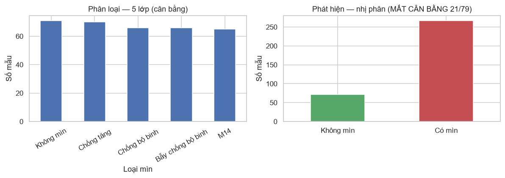 | 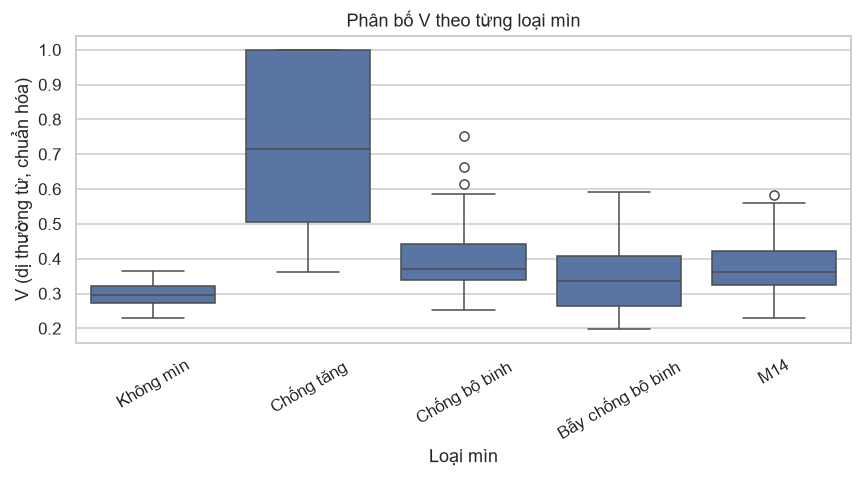 |
| 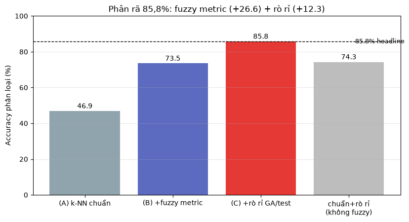 | 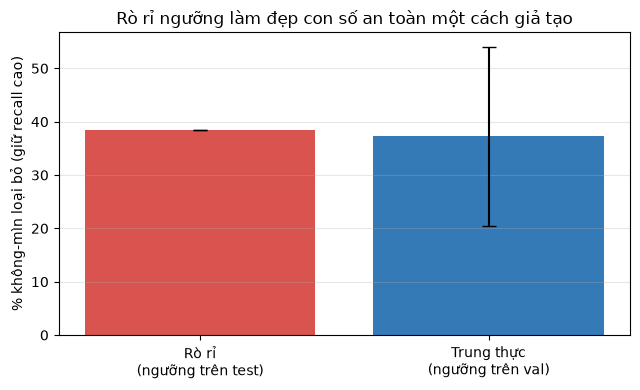 |
| 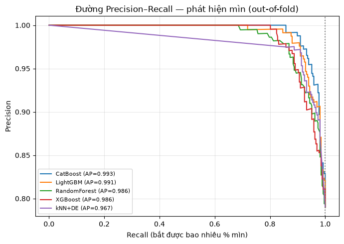 | 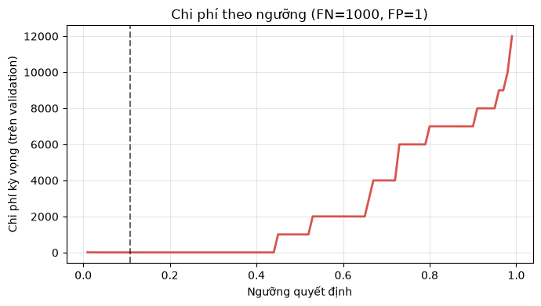 |
| 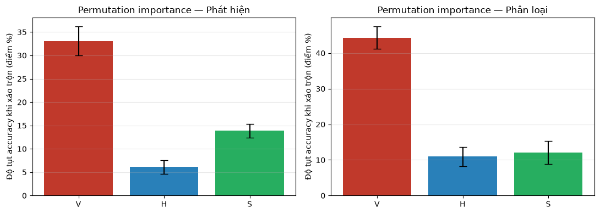 | 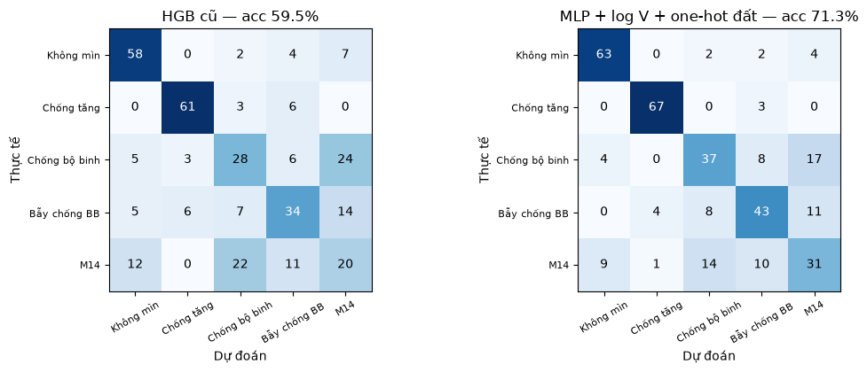 |

---

## Giới hạn và hướng phát triển

**Giới hạn:**
- Dữ liệu phòng thí nghiệm (338 mẫu), không có nhiễu nền kim loại như thực địa
- Dữ liệu đã chuẩn hoá sẵn trên toàn tập — còn một mức rò rỉ nhỏ không loại bỏ được
- Các lớp mìn nhỏ (chống bộ binh, M14) vẫn khó tách biệt
- Không ngưỡng cố định nào đảm bảo 0% bỏ sót trên dữ liệu mới

**Hướng phát triển:**
- Thu tín hiệu sóng thô + 1D-CNN
- Đánh giá theo nhóm (ví dụ tách theo loại đất) để kiểm tra khả năng tổng quát
- Conformal prediction thay ngưỡng cố định
- Tích hợp IMSMA/GIS
